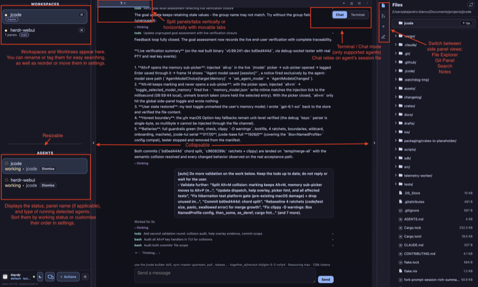
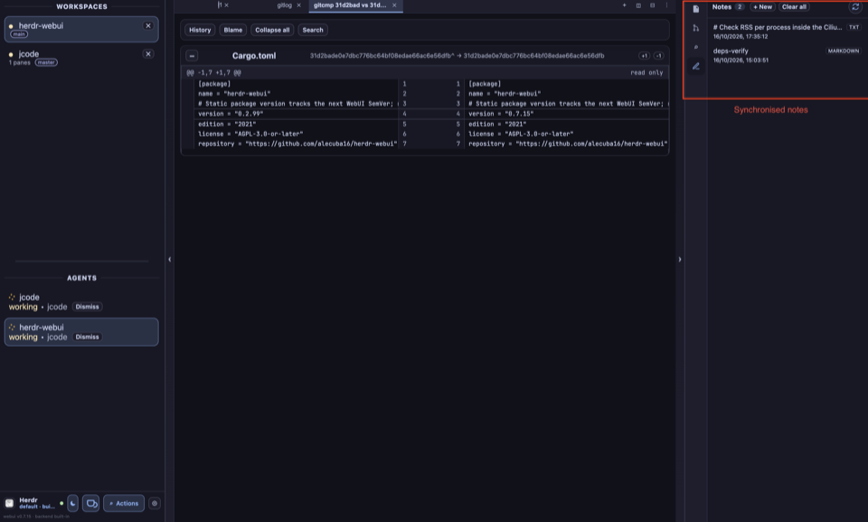
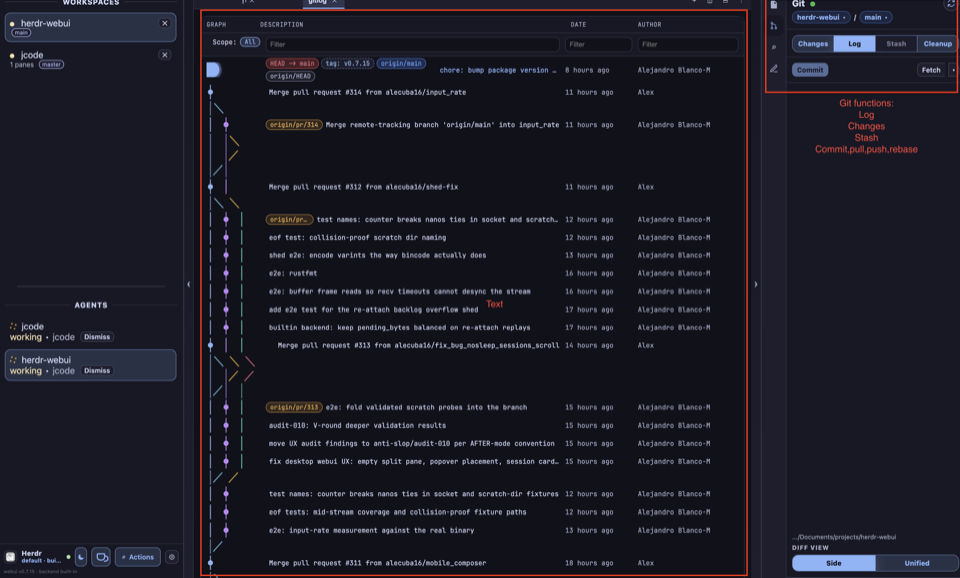
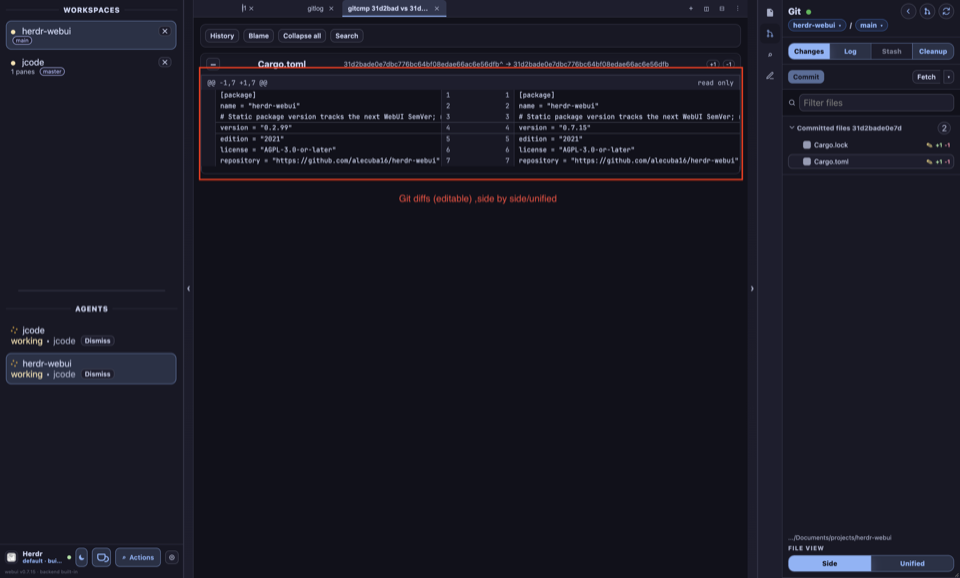
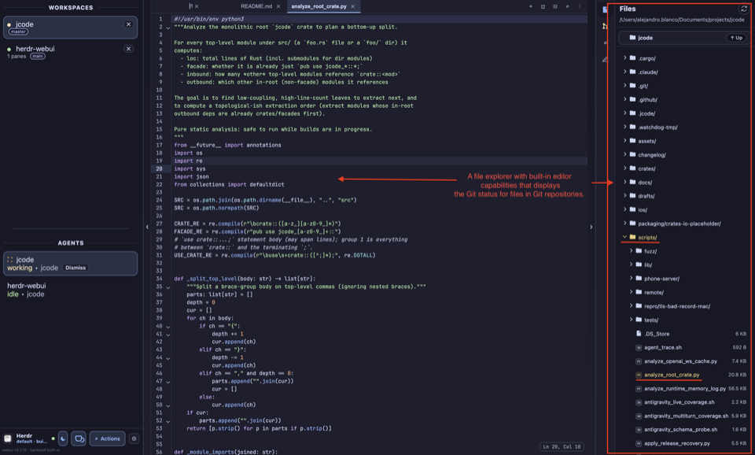
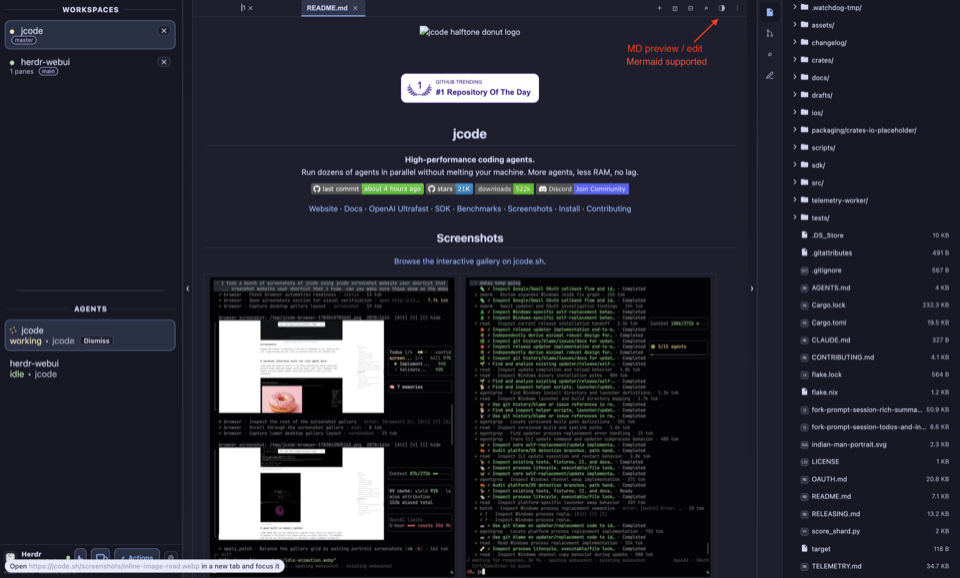

# WebUI screenshots

The browser UI of `herdr-webui`, captured from a live session against the
built-in backend on real workspaces (jcode and herdr-webui itself). The
animated GIF (`screens/webui/00-webui-tour.gif`) walks the captures slowly,
three seconds per screen.

All shots are one Arc window at 960px wide, dark theme, desktop layout. The
workspace sidebar (WORKSPACES, AGENTS) is present in every capture.

## Workspace and agents

| Shot | What it shows |
| --- | --- |
|  | Workspace with the Files view open and a jcode agent pane in Chat mode: agent rows with live status under AGENTS, agent transcript with todo list, and a `Send a message` input at the bottom. |
|  | Notes rail view over a busy session: two synchronized notes (`deps-verify` markdown editing, note list with timestamps) next to the Git compare of `Cargo.toml` between two commits, read-only diff, agent rows working below. |

## Git view

| Shot | What it shows |
| --- | --- |
|  | Git view on the Log tab: commit graph (GRAPH, DESCRIPTION, DATE, AUTHOR columns), tag and remote annotations (`HEAD -> main`, `origin/main`, `tag: v0.7.15`), scope filter, and the Changes/Commit/Log/Stash/Cleanup tab row. |
|  | Two-commit compare opened from the Log tab: `Cargo.toml` side-by-side diff of `31d2bade...` vs itself, committed-files list with +/- counts, file filter, read-only mode, and Side/Unified toggle in the FILE VIEW footer. |

## File explorer

| Shot | What it shows |
| --- | --- |
|  | File explorer with `analyze_root_crate.py` open in the built-in editor: line numbers, syntax highlighting, Ln/Col position readout, git-status colored tree on the side, and file sizes in the listing. |
|  | Markdown preview of `README.md`: rendered headings, links, badges, and the `Screenshots` section, MD preview/edit toggle with Mermaid support, file tree and editor tab strip around it. |

## Notes

The tour GIF is generated from the six PNGs with two-pass ffmpeg
(`palettegen`/`paletteuse`, 960px, three seconds per frame):

```bash
cd docs/screens/webui
ffmpeg -y -framerate 1/3 -pattern_type glob -i '0*.png' \
  -vf "palettegen=stats_mode=diff" -update 1 palette.png
ffmpeg -y -framerate 1/3 -pattern_type glob -i '0*.png' -i palette.png \
  -lavfi "[0:v][1:v]paletteuse=dither=bayer:bayer_scale=5" \
  -gifflags -offsetting -loop 0 00-webui-tour.gif && rm palette.png
```

The source captures were taken at ~3450x2070 and downscaled to 960px wide;
frames are padded to a common 960x578 canvas so the GIF decoder sees one
frame size throughout.

- See [features.md](features.md) for the full WebUI feature list and
  [technical-details.md](technical-details.md) for how the views are built.
- The TUI equivalents live in [tui-screenshots.md](tui-screenshots.md).
